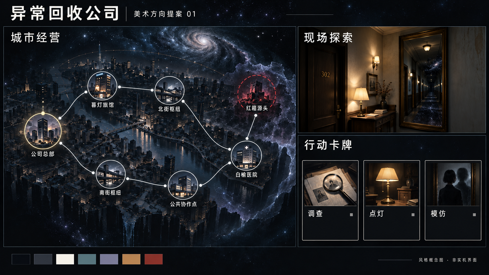

# Joy 美术与界面需求规格说明书

## 01 文档状态、依据与交付范围

**版本：0.1｜日期：2026-09-24｜状态：评审稿｜配套游戏需求：v0.3（策划 v0.2 对齐修订）**

本文件把《整体美术风格提案 v0.1》转化为可制作、可检查的美术与界面要求，供四人团队讨论、AI 生成素材、界面设计与后续实现使用。美术需求以 AR 编号，验收以 AT 编号；独立版本管理，不覆盖游戏需求的 FR、AC 或 D 编号。

用户已要求编写本文件并在完成后同步 GitHub。该授权确定本次文档交付，不等于配色、构图、所有 M2 方案或最终美术已冻结。本次不生成新的游戏素材或实现界面。文中样稿、配对状态与客户端验收均未执行；既有总览图只作为视觉参考。

### 1.1 来源与效力

| 来源 | 固定版本与用途 |
| --- | --- |
| S-A 美术提案 | main 提交 `74f2aa72eea1d2549db7d5270f40a32dec516cf8` 的 `docs/design/美术风格提案_v0.1.md`，§1-12；定义候选视觉方向及首轮样稿范围 |
| S-B 视觉样板 | 同提交的 `output/art/joy-art-board-v0.1.png` 及两份提示词；用于气质、材质与版式讨论，非实机截图或状态规范 |
| S-R 游戏需求 | 同提交的 `docs/requirements/Joy_需求规格说明书_v0.3.md`；原发布提交为 `693307638a7d9521b8ee185628d8d685b66e15b2`，玩法与已知信息边界以它为准 |
| S-D 策划与 Wiki | 同提交的策划 v0.2 及 `docs/wiki/`；辅助理解场景、物品及 M2 配置，Wiki 的实现观察不自动证明本次界面验收通过 |
| S-U 本次会话 | 用户要求“提个需求文档”，并确认完成后同步 GitHub；此前“第一城收敛银河”等审阅建议仍是待讨论建议 |

[固定版本美术提案](https://github.com/bddfs/Joy/blob/74f2aa72eea1d2549db7d5270f40a32dec516cf8/docs/design/美术风格提案_v0.1.md) · [游戏需求 v0.3](https://github.com/bddfs/Joy/blob/74f2aa72eea1d2549db7d5270f40a32dec516cf8/docs/requirements/Joy_需求规格说明书_v0.3.md) · [地点百科](https://github.com/bddfs/Joy/blob/74f2aa72eea1d2549db7d5270f40a32dec516cf8/docs/wiki/locations.md)。

状态标签：“继承”表示引用游戏需求，保留原文的基线、用户确认或 M2 待验证状态；“提案”表示本版拟议美术规范；“建议”表示本次补充的制作或验证方法。混合条款中，玩法事实按继承部分，呈现方法按提案部分。不得把“继承”一律解释为用户已逐项确认。

运输仅预览已知后果、疾走保留模仿参考、成长不另设遗物系统等既有用户决定继续有效。工具次数、灯具支援与部分时序是游戏需求中的 M2 验证方案；本稿只要求界面如实呈现选定配置，不将其升级为最终平衡。若玩法文档后续修订，相应 AR、样稿与 AT 一并更新。

### 1.2 首轮交付包

| 包 | 本轮交付物 | 通过后可做什么 |
| --- | --- | --- |
| P1 城市经营 | 1 套完整调度界面稿；含真实七节点、事务与人力，并提供营业和归属状态对照 | 冻结城市地图和状态组件的视觉规范 |
| P2 旅馆现场 | 同一构图的现实基础与异常局部稿；照明状态明确；配房间导航与动作预览 | 冻结固定视角、材质及局部异常语言 |
| P3 行动卡牌 | 调查、点灯、模仿三张同版式卡；另做五张手牌及额外借用区的组合稿 | 冻结卡框、文字区、费用和参考显示 |
| P4 实物与工具 | 座钟、灯各一套主体及合法状态叠层；隔离工具余量用组件表示 | 冻结同物品跨界面的身份与状态显示 |
| P5 长文本与反馈 | 真实长预览、事实/候选/规程、护符反馈及日结顺序稿；含静态版本 | 验证信息可读、操作稳定、演出与事实一致 |

“一套”允许状态变体和组件复用，不把每个叠层算成重新生成一张插画。首次验收限上述样稿与必要的状态演示；完整三城、全卡池、全套员工立绘、3D 漫游、完整特效库、音频制作及 Steam 商店素材不纳入本轮。建议的分层源文件和清单随上述包交付，不构成新增全量资产任务。

## 02 视觉方向与公共语言

图 1：来自 S-B 的现有总览样板，仅用于讨论气质；本次未生成新美术。正式状态与交互以本稿条款为准。

### 2.1 候选风格

**AR-01 题材与身份〔提案〕。** 统一采用“深空星图、现代城市怪谈、专业公司的调查档案”方向。城市节点保留建筑、门牌及生活痕迹；员工、工具与卡牌保留公司身份。宇宙感承担共同视觉语言，不据此新增宇宙旅行、星球地图或其他世界观机制。来源：S-A §1、3。验收：AT-01。

**AR-02 配色与材质〔提案〕。** 下表作为首轮试色。场景采用低饱和半写实质感，木材、玻璃、金属、纸张可区分；文字和功能图形使用稳定实底。约 75% 暗场、20% 中间明度、5% 高亮仅是构图起点，正文和必要操作区不受压暗比例约束。来源：S-A §4。验收：AT-01、AT-11。

| 色名 | 试用色值 | 用途与限制 |
| --- | --- | --- |
| 深空底色 | `#080C15` | 大背景与地图空白，不吞没可交互轮廓 |
| 深石板色 | `#171E2B` | 卡牌文字区、预览与信息面板 |
| 暖灰白 | `#E9E6DE` | 正文、清楚的图标与线条 |
| 冷青色 | `#8CBAB7` | 公司连接、辅助选中提示；不单独承担状态含义 |
| 灰紫色 | `#9A91AF` | 已可见的异常现象与氛围，不编码隐藏真值 |
| 灯光琥珀 | `#D3AD6B` | 灯具、营业窗灯和人的活动；不代表普遍安全 |
| 暗珊瑚红 | `#C66D70` | 已知警告、实际伤害和失效标记 |

**AR-03 层级与装饰〔提案〕。** 星尘、颗粒、光晕位于信息层后方，避开正文、节点名和路线。功能边框、按钮与档案卡使用现代、克制的线形。装饰不伪装成可点击对象；辉光、玻璃模糊或背景细节不能成为读懂文字和目标的必要条件。来源：S-A §4、5、7。验收：AT-02、AT-11、AT-13。

**AR-04 现实与宇宙感的强度〔建议〕。** 首轮比较“现实城市为主、宇宙异常局部出现”与“较强宇宙环境包围城市”两种强度，优先通过现有构图的调整评审，不要求新增两套完整资产。第一城保留多少银河、悬浮感及空间断裂待 DA-01 确认；此前收敛银河的建议不作为禁令。三城递进属于完整产品方向，本轮只登记视觉原则。来源：S-A §6、10、12；S-U 审阅建议。验收：AT-01。

**AR-05 颜色与含义〔继承+提案〕。** 归属、营业、选中、队伍、危险分别使用可解释的文字、形状或图标，颜色仅辅助。暖灯不保证安全、暗色不等于不可操作、红色不依据未发现的规则预先出现。未知信息使用合法占位，不靠美术补全答案。来源：FR-UI-01/02/05/07、NFR-02；S-A §4、8。验收：AT-03、AT-05、AT-11。

## 03 城市调度界面

**AR-06 地图拓扑〔继承〕。** M2 样稿精确显示下列七节点、七条双向边。线条必须能连续追踪、端点落在对应节点，装饰星线不加入可操作网络。节点位置可为构图调整，相邻关系不可擅自改变。未知地点的名称和身份按可见性显示。来源：FR-MAP-01/03，第 15.2 节；S-A §5。验收：AT-02。

| 路线 | 节点连接 |
| --- | --- |
| 北线，4 条边 | 公司总部 - 暮灯旅馆 - 北街枢纽 - 白榆医院 - 红箱源头 |
| 南线，3 条边 | 公司总部 - 南街枢纽 - 公共协作点 - 白榆医院 |

**AR-07 节点状态独立表达〔继承+提案〕。** 同一点可同时具有归属、设施、营业资格、队伍位置、选中和已知威胁。各状态独立叠加，不复用一个光圈表达全部含义。节点失效保留设施和公司标识；营业状态可查缺少的已知条件，新建明确显示“明日生效”。来源：FR-NODE-02/03/05、FR-DAY-07、FR-UI-01/02；S-A §5。验收：AT-03、AT-12。

| 状态维度 | 必须表达 | 建议组件 |
| --- | --- | --- |
| 地点与归属 | 建筑类型、可见名称、公司是否已接管 | 建筑缩略图、名称、独立公司牌匾 |
| 建设与营业 | 可接管/施工中、明日生效、营业中、缺驻站、断联或已知受影响；归属由实际状态决定 | 状态文字、设施图层、原因详情 |
| 位置与选择 | 哪队在此、当前操作对象是谁 | 队伍编号徽记、中性选择框 |
| 公开威胁 | 已知受影响状态、公开传播目标与封控 | 独立威胁标记和对应事件说明 |

**AR-08 路线、传播与封控〔继承+提案〕。** 可通行边、断路、运输、传播预告、封控使用可区分的图层与符号；断路有缺口和文字原因，传播箭头指向具体目标，封控对应具体边。只表现当前可知信息，不预画隐藏运输入侵、危险范围或安全通道。来源：FR-SPR-01/02/03/05、FR-UI-02/07；S-A §5、8。验收：AT-02、AT-05、AT-13。

**AR-09 事务与共享资源〔继承+提案〕。** 准备界面持续显示人力总量、可用/占用、事务位、工具预留、已付/待付与条件收入。独立任务卡槽表达占用，同一工具即使余量充足也不能在视觉上分属两队。员工五类状态与 M2“施工·研究”按实际配置呈现；取消只释放实际未消耗部分。M2 的 6 人、2 事务为试排参数。来源：FR-DAY-03/04、FR-STAFF-01/02、FR-DSP-05、FR-ECO-03/06、FR-ITEM-06/07。验收：AT-04、AT-09。

**AR-10 城市工作区稳定〔提案〕。** 浏览节点和长事务列表时，人力、工具、余额与锁定按钮保持可访问。已经营节点保留原位置及状态，经营成长由已建成设施和实际生效能力表达。预览与明细可联动选中节点；不以镜头漂移或持续闪烁强迫玩家重新寻找对象。来源：FR-UI-03/13/15；S-A §5、9。验收：AT-03、AT-11。

## 04 现场、证据与规则信息

**AR-11 固定现场与可靠导航〔提案〕。** 使用固定视角 2D 场景与房间导航，按需要采用少量分层和局部动画。同房间正常与异常稿保持构图锚点；入口、当前房间、可交互对象、行动费用、出口距离与撤离操作始终可定位。现有动作和房间连接决定交互位置，插画不能额外创造可进入门或可拿取物。来源：FR-FLD-03/04/05、FR-UI-04/09/13；S-A §6。验收：AT-06。

**AR-12 可见事实与隐藏真值〔继承〕。** 事实、候选与已确认规程使用不同档案标记。公开信息相同、隐藏 A/B 真值不同的状态，在产生新的不同可观察结果之前，不通过纹理、镜面、粒子、图标、排序、按钮或弹窗形成答案差异。发生真实观测后，允许按事实不同反馈，不能为了画面一致隐瞒反噬。来源：FR-RULE-03/10、FR-UI-05/07/14；S-A §6、8。验收：AT-05。

**AR-13 照明、反噬与防护〔继承+提案〕。** 装饰暖灯与玩法照明状态分开标识；“看起来明亮”不能暗示未满足的照明条件。反噬、防护抵挡和最终心志分别反馈并保留事实日志；心志未减不能隐藏护符消耗。未发生反噬显示“未观察到”，不宣布房间永远安全；确认前不写出隐藏规则的完整名称与条件。来源：FR-FLD-08、FR-RULE-10、FR-UI-05/08；S-A §8、9。验收：AT-05、AT-06。

**AR-14 时间与资源可读〔继承+提案〕。** 经营日与现场轮次分开标注，现场行动、心志、护符、灯光、异动、封门期限及当前所需墨水均可查。阶段、对象与费用使用真实状态；看地图、翻日志或打开菜单不播放时间推进、扣费或领取演出。不同阶段需要的信息可分层，但不能隐藏即将执行动作的关键代价。来源：FR-DAY-01/04、FR-FLD-02/03/05、FR-UI-04/13；S-A §8。验收：AT-06、AT-11。

## 05 卡牌、实物与公司资产

**AR-15 档案卡模板〔提案〕。** 三张首轮卡共用名称、费用、目标/条件、简短效果和耗尽标记的位置。插画上部主体清楚，下部文字区为实底；长名称不得挤掉费用，完整效果可展开。正式规则、数字和功能图标由界面排版，不烘焙进 AI 插画；概念图中的文字不直接作为游戏资源。来源：FR-UI-10/13；S-A §7、12。验收：AT-07、AT-11。

**AR-16 稳定手牌槽〔继承+提案〕。** 按 M2 需求以五张手牌试排，同轮使用后原槽留空，其余牌位置与尺寸不变，换轮才按抽牌填槽。额外借用牌使用独立区域；允许复用三种首轮卡插画来测试布局，不据此新增卡种或改变牌组。主要执行、结束回合按钮在长说明打开后仍可操作。来源：FR-FLD-02、FR-UI-13；S-A §7、8。验收：AT-07、AT-11。

**AR-17 模仿参考与当前目标〔继承〕。** 分别展示“参考动作”和“当前对象/位置”。搜查后疾走保持搜查参考，目标改为所在房间；演出将动作施加到当前对象，不复刻旧物品或旧奖励。封装牌等不合资格参考显示已知原因；基础封装不覆盖参考等 M2 补充按当前游戏需求执行。新出勤/换层清空参考，不能保留失效提示。来源：FR-MIM-01/02/03、FR-CARD-05、FR-UI-12。验收：AT-08。

**AR-18 弃牌、耗尽与奖励〔继承+提案〕。** 成功使用模仿显示本次出勤耗尽，未使用的模仿按普通弃牌处理；界面能区分手牌、弃牌和耗尽。动作、随机奖励选择、实际领取使用不同反馈，拒绝领取不表示此前合法执行动作未扣费。稀有揭晓沿已有系统表达，不新增独立遗物栏。来源：FR-FLD-02、FR-MIM-04、FR-UI-10/14、FR-CARD-06。验收：AT-07、AT-08。

**AR-19 实物身份与状态叠层〔继承+提案〕。** 同一实例从现场、已发现未入包、入包、封装到归库保持主体轮廓和识别特征，用状态叠层表示变化；出现多个界面缩略图不表示拥有多件。座钟只展示合法归属/封装/交付状态，灯具增加安装状态，不给座钟虚构安装能力。物品入包、归库与出售/交付分别标识。来源：FR-ITEM-01/02/03/04、FR-UI-09/10；S-A §7。验收：AT-09。

**AR-20 工具次数与灯具支援〔继承+提案〕。** 隔离工具分开显示实物归属、总剩余次数、预留与已消耗，补充工程标明真实生效时点。灯具显示未封装暂存、已封装归库、安装位置、当日已用/未用额度；未封装不显示可出售或已生效，停业暂停未用能力，同日拆装不刷新额度。具体容量、费用和隔日条件沿用 M2 验证方案。来源：FR-ITEM-06/07/08、FR-NODE-07。验收：AT-04、AT-09。

**AR-21 成果与生效反馈〔继承+提案〕。** 物品价值、潜在合同收入、当前现金分别表达；仅在真实入账时播放增加现金反馈。工程完成、次日可营业和实际营业不混为同一亮灯状态，不能以动画完成替代游戏生效事件。已付预付在预测中不重复扣除，条件收益不表现为保证到账。来源：FR-ECO-01/02/03/06、FR-DAY-07、FR-UI-15。验收：AT-09、AT-12。

## 06 真实文字、预览与操作

**AR-22 文字基准与缩放〔提案+建议〕。** 以 1920×1080 画布、正文 18-20 px 作为首轮试排起点，并检查 100%、125%、150% UI/文字缩放。该组值是本次验证配置，不冻结最低分辨率、字体或双平台字体指标。使用当前内容表中最长实际中文，并为未来加长情形附压力文案；两者分开记录。来源：S-A §8；NFR-01/02、D-12。验收：AT-11。

**AR-23 信息层级与持续可见〔继承+提案〕。** 左侧目标/状态、中间现场、右侧常驻预览、下方手牌为初版布局。关键费用、目标、风险、撤离条件不能只靠悬停或瞬时提示呈现。长日志和详细解释允许滚动、折叠或展开，不能截断唯一的规则信息或遮住执行/结束按钮；缩放后可改变布局组织。来源：FR-UI-04/08/09/13/15；S-A §8。验收：AT-10、AT-11。

**AR-24 多通道辨识〔继承+提案〕。** 在灰度、静音和低动态状态下，选择、归属、营业、断路、危险、反噬、防护和消耗仍能通过文字与形状辨认。正文和重要轮廓不依赖极细发光线；图标配已知语义及必要名称。实际字体和配色的可读性须用目标显示环境复核，不能只凭色值表宣称达标。来源：FR-UI-05/06、NFR-02；S-A §4、8、9。验收：AT-03、AT-11、AT-13。

**AR-25 常驻预览与确认分级〔继承〕。** 预览依次说明动作/对象/费用、基础效果、相关已知会触发、相关已知不触发、尚不确定。公开状态相同的未知规则不得让预览、禁用原因或危险弹窗产生泄密差异。普通动作按已有选择/提交流程；锁定、撤离清单、唯一稀有资产、覆盖存档与已知立即失败的确认按 FR-UI-14，不由美术另加全屏弹窗。来源：FR-UI-07/08/14。验收：AT-05、AT-10。

### 6.1 长预览的样稿内容

P5 至少选择当前规则中的一次正常搜查、一次护符可能参与的已知后果、一次仍存在未知运输风险的预览；保留真实对象、费用及当前已掌握的证据。候选真值与不能保证的净损失不写入预览。制作时记录引用的内容版本、文本字符数、字体、画布和缩放，避免用简短占位句代表长文本验收。

## 07 动效、结算与续玩

**AR-26 动效不改变操作事实〔继承+提案〕。** 装饰星尘不承担计时，选中聚焦后稳定，调查确认可回看。不可因镜头、动画或音效改变目标、增加扣费、隐去已知风险或故意制造操作延迟。反馈发生在对应游戏事件之后，连播时仍可查询当前事实。来源：FR-UI-05/06/15；S-A §9。验收：AT-12、AT-13。

**AR-27 日结按实际事件顺序〔继承〕。** M2 的演出和明细遵循下表，替代美术提案 §9 中“收支、工程、扩张、交接”的简写。收入汇总可单独查阅，但逐步演出不能调换因果。扩张共用快照，不以动画先后改变结果；跳过动画仍保留完整流水。来源：FR-DAY-06/07/08、FR-SPR-03/04/05、FR-UI-15。验收：AT-12。

| 次序 | 显示事件 | 必须保留的边界 |
| --- | --- | --- |
| 1 | 归队、真实消耗与运输后果 | 撤出、未撤出、遗落不同；发生过的运输结果保留 |
| 2 | 证据归档与合同交付 | 信息按隔日规则使用；源头交付只取消未执行的对应扩张 |
| 3 | 工程与处置完成 | 不把补充、补封装或新建直接演成当日可用/营业 |
| 4 | 晨间资格收入与必要费用 | 不补发本日新建/修复收入；已付预付不重复扣 |
| 5 | 共同快照扩张与封控结果 | 演出序列不改变同时结算；保留真实入侵/断联状态 |
| 6 | 交接、经营失败或期限结果 | 必要费用不足先失败，付清后 0 余额按规则合法 |
| 7 | 实际进入的新日/新城信息 | 不额外开放已交接旧城的操作时段 |

**AR-28 静态模式与恢复反馈〔继承+提案〕。** 装饰动效提供静态或低动态版本，无强频闪、持续抖动或正文色散。关闭动画或静音不减少必要信息。继续游戏后显示最后成功的完整检查点与真实状态，不重播成新的领取/入账；轮内回退范围按 FR-SAVE-05/06，不能靠视觉保留未保存收益。来源：FR-SAVE-05/06、NFR-02；S-A §9。验收：AT-13。

## 08 AI 素材制作与交付约定

**AR-29 可组合资源〔提案〕。** 场景基础、异常局部、灯光、物品主体、状态叠层、人物、背景与功能 UI 分开制作。房间同构图变体保持锚点与尺寸；主体不随状态改变身份。文字、路线、数值、按钮与功能图标由可编辑的界面资源承载，不能用一张不可编辑的生成图片代替全部界面。来源：S-A §11、12。验收：AT-14。

**AR-30 导出与适配〔建议〕。** 概念审阅可交 PNG；需要透明叠层的栅格资产保留 Alpha，检查暗底/亮底下的边缘与锚点。随源文件记录画布、有效区域、目标显示尺寸、缩放方式及适用背景。最终贴图尺寸、图集、压缩、字体导入与资源预算由技术适配确认，本版不虚定 4K、固定显存或帧率。来源：S-A §12；NFR-01/05、D-12。验收：AT-14、AT-15。

**AR-31 AI 生成一致性〔提案〕。** 使用已选样板及统一的视角、材质、光线和色彩描述，每项另写用途、状态、尺寸与必须保留的结构。保留原始/修订提示词、参考来源和编辑步骤；模型版本、种子等只在工具实际提供时记录，不编造。批量产出前比较首轮同类资源，发现主体、视角或光源漂移时修正参考与提示词。来源：S-A §12。验收：AT-14。

**AR-32 版本、清单与评审状态〔建议〕。** 每项资源有稳定 ID、版本、源文件、导出文件、用途、尺寸、状态列表、引用内容版本、提示词/参考来源、权利或许可信息、评审状态及对应 AR/AT。文件名可采用 `joy_<type>_<subject>_<state>_v01.png`；命名为建议，不能把同名文件默认为已批准替换。游戏使用的素材与未采用草稿明确区分，生成缓存和编辑器临时文件不进入正式交付。来源：S-A §12；S-U 四人协作方向。验收：AT-14、AT-15。

### 8.1 首轮资产与状态清单

| 资源 ID | 对应交付包 | 最小状态/变体及交付说明 |
| --- | --- | --- |
| VIS-CITY-01 | P1 | 完整城市画布与七节点七边；保留可编辑路线和名称 |
| VIS-NODE-01 | P1 | 地点主体、归属、建设/营业、选中、队伍、已知威胁组件及组合表 |
| VIS-PLAN-01 | P1 | 事务位、人力、工具预留、收支汇总和锁定操作 |
| VIS-ROOM-01 | P2 | 同构图基础与异常局部；照明状态和交互锚点说明 |
| VIS-CARD-01/02/03 | P3 | 调查、点灯、模仿；共用文字模板和状态叠层 |
| VIS-HAND-01 | P3 | 五手牌、用后留空、额外借用区和固定操作按钮 |
| VIS-ITEM-01 | P4 | 座钟：已发现、携带、封装、归库/交付；不添加安装状态 |
| VIS-ITEM-02 | P4 | 灯：未封装暂存、封装归库、安装与当日支援已用/未用 |
| VIS-TOOL-01 | P4 | 隔离工具唯一归属、剩余/预留/消耗、补充待生效组件 |
| VIS-PREVIEW-01 | P5 | 长动作预览及事实/候选/规程、未知后果标记 |
| VIS-FEEDBACK-01 | P5 | 护符抵挡、日结时序、静态反馈与检查点恢复状态稿 |

以上是交付组织，不是生成图片的固定张数。隔离工具和反馈可用组件或状态稿实现；无需为本文件制作额外角色立绘、动画帧库或新的玩法内容。

## 09 验收场景与记录

所有 AT 当前状态均为“未执行”。静态稿通过只能证明该状态下的视觉表达；标为“交互/客户端复核”的部分须在相应实现存在后执行。每次记录样稿/构建版本、配置、输入、预期、实见、截图/记录及未覆盖部分，不把纸面评审写成玩法或双平台验收通过。

**AT-01 风格与强度评审〔状态稿〕**
四人对照同一批样稿，指出城市经营、公司调查、现实场所与宇宙异常的具体视觉依据，记录配色、半写实程度和强度偏好。明确 DA-01/02 的结论与保留意见；未决定前保持候选版本，不据总览图自动批准全部资产。覆盖 AR-01/02/04。

**AT-02 七节点与七连线〔状态稿〕**
逐条核对 AR-06 的连接、名称和端点；北街枢纽不得直接接红箱源头。分别显示双向通行、断路、已知传播和封控；装饰星线不被作为第八条通路。缩放后仍能追踪两线在医院汇合。覆盖 AR-03/06/08。

**AT-03 独立经营状态〔状态稿；交互复核〕**
同屏或同组件状态表呈现可接管但未建成（已锁定建设时标施工中）、建成待次日、营业、缺驻站、断联、已知受侵；其中一处叠加选中与队伍。归属按真实状态显示，施工不代表已营业。逐项读出地点、归属、营业资格、选择和位置，失效后设施仍在。转换为灰度仍能按文字/形状区分。覆盖 AR-05/07/10/24。

**AT-04 人力、事务与唯一工具〔状态稿；交互复核〕**
以 6 人、2 事务试排，混合驻站、两人出勤、施工·研究和恢复，资源汇总与任务卡一致。唯一工具余两次时，两队不能同时显示已领到同一工具；取消未执行预留与执行后消耗分别呈现。补充待日终完成、次日可用，不能提前画成已可派。覆盖 AR-09/20。

**AT-05 隐藏信息配对〔状态稿；交互/客户端复核〕**
建立仅隐藏镜中住客 A/B 不同的配对状态，公开证据、当前位置、手牌和资源相同；在出现不同可观察结果前比较场景、纹理、灯光、粒子、音效、排序、按钮、预览、目标高亮和弹窗，不得据此辨认真值。再对未知运输规则作同类配对，不预标受影响节点或零风险。执行真实试探后允许依据事实分化：护符挡住反噬时显示触发、消耗与心志结果，但不直接写隐藏因果。覆盖 AR-05/08/12/13/25。

**AT-06 房间、照明与时间〔状态稿；交互复核〕**
同一房间的基础、异常、照明状态保持门、对象与出口锚点；用户可指出当前房间、退出路径、动作费用与剩余时限。区分装饰台灯与实际照明状态；打开地图、日志、背包时没有扣费或推进回合演出。覆盖 AR-11/13/14。

**AT-07 五手牌及额外区域〔状态稿；交互复核〕**
五张手牌中使用第二、第四张，原槽留空，其余不移位；新增借用牌不挤动原槽，换轮按实际抽牌填充。三种模板检查名称、费用、目标、效果、耗尽标记；长说明不遮住执行和结束回合。未用模仿与成功耗尽分别显示。覆盖 AR-15/16/18。

**AT-08 模仿参考与真实奖励〔状态稿；交互/客户端复核〕**
甲室搜查后疾走至乙室，参考保持搜查而目标与库存为乙室；模仿演出不复制甲室旧实物。再检查封装牌覆盖为不合资格、基础封装不覆盖，以及换层/新出勤清空参考；成功使用进入本次出勤耗尽，同次出勤内回访或换轮不刷新，新出勤按原方案恢复资格并清空参考。覆盖 AR-17/18。

**AT-09 实物、工具与实际生效〔状态稿；交互/客户端复核〕**
追踪同一灯的发现、入包、未封装暂存、补封装、归库和安装，主体可辨且归属唯一。未满足条件时不显示可售/生效；支援用后有持续标记，停业、拆装和继续游戏不假装刷新。座钟仅走其合法状态。逐笔核对获取、合同完成与现金到账，工程和预付不出现提前或重复收益。覆盖 AR-19/20/21。

**AT-10 预览与确认层级〔状态稿；交互复核〕**
正常搜查、护符参与后果、未知运输三个长预览分别标明确定信息和不确定部分；相同公开信息下不随隐藏真值换色、禁用或弹出危险确认。普通动作无需额外美术弹窗，既定锁定/撤离/稀有资产/覆盖存档/已知立即失败确认保持。查看和取消不出现扣费演出。覆盖 AR-23/25。

**AT-11 长中文、缩放与灰度〔状态稿；目标环境复核〕**
在 AR-22 的画布与三档缩放下同时放入实际最长卡名、五手牌、额外借用、状态栏、模仿参考、目标与常驻预览，打开长日志。名称/费用/危险不丢失；完整文本可展开查看；执行与结束按钮可访问。灰度下可区分关键状态，明暗背景均不吞掉文字与边缘。记录超长压力文案结果，不替代真实内容检查。覆盖 AR-02/03/05/10/14/15/16/22/23/24。

**AT-12 日结演出与账目〔状态稿；客户端复核〕**
按 AR-27 核对逐项事件与最终流水。新建当日不画为营业，旧点修复不补收入，已发生运输结果不因源头交付抹去。跳过动画与完整播放的资源、营业和交接结果相同。账目样例输入为晨间资金 28、抢修预付 2、调查预付 1、营业收入 2、基本支出 2；准备/锁定/日终均为 25，不因演出再次扣成 22。费用不足与付清为 0 分别显示正确结果。覆盖 AR-07/21/26/27。

**AT-13 静态、静音与继续游戏〔状态稿；客户端复核〕**
关闭装饰动态并静音，仍可读断路、反噬、抵挡、封控、危险和撤离条件。检查点恢复后显示真实额度、物品与已保存状态，不把已领取奖励重播成新收益；轮内有/无后续奖励检查点分别按游戏需求恢复。未执行客户端测试时只记录状态稿覆盖。覆盖 AR-03/08/24/26/28。

**AT-14 资产交接与一致性〔文件检查〕**
按清单逐项查源文件、导出、尺寸、透明边缘、锚点、版本、提示词与参考记录；同物品各状态可叠加且身份一致。移除插画后正式文字、功能图标、线路和按钮仍可编辑；无生成乱码被误用为正式文本。实际使用字体和外部参考的许可状态有记录。覆盖 AR-29/30/31/32。

**AT-15 追踪与范围核对〔文档检查；集成后复核〕**
P1-P5 的每项资产关联 AR 和 AT，状态明确为草稿/待评审/已选用/待验证等；三城全量、额外人物、3D 和完整动画库未被暗中加入。导入原型后在拟支持的 Windows/macOS 上复核文字、透明边缘和缩放差异；本稿不声称该项已完成或已确定最低规格。覆盖 AR-30/32；游戏 NFR-01/05、D-12。

## 10 待定项、追踪与评审顺序

### 10.1 待定决策

| 编号 | 待决定内容 | 建议确认时点 |
| --- | --- | --- |
| DA-01 | 现实城市与宇宙环境比例、首城银河/悬浮感、恐怖强度 | P1/P2 样稿讨论后、批量生成前 |
| DA-02 | 半写实程度、色板微调、装饰密度、功能边框与图标语言 | 首轮同类样稿比较后 |
| DA-03 | 最终中文字体及许可、字号、缩放/布局策略、最低可用窗口规格 | 真实长文案原型验证后；衔接游戏 D-12 |
| DA-04 | 具体素材尺寸、锚点格式、透明/切图/图集方案、导入与性能预算 | 样稿进入目标引擎试验后 |
| DA-05 | 动效时长、可跳过范围、静态/低动态设置入口 | 反馈原型验证后，不改变游戏结算时序 |
| DA-06 | 最终 logo、人物面貌、全量三城资源与发行美术范围 | 后续内容计划明确后；不阻塞本轮样稿 |

### 10.2 来源与验收覆盖

| 需求组 | 主要来源 | 验收 |
| --- | --- | --- |
| AR-01 至 05 视觉语言 | S-A §1、3、4、10；FR-UI、NFR-02 | AT-01/03/05/11 |
| AR-06 至 10 城市 | S-A §5；FR-MAP/NODE/DSP/STAFF/ECO/UI | AT-02/03/04/05/11/12 |
| AR-11 至 14 现场与知识 | S-A §6、8；FR-FLD/RULE/UI | AT-05/06/11 |
| AR-15 至 18 卡牌 | S-A §7；FR-CARD/MIM/UI | AT-07/08/11 |
| AR-19 至 21 实物 | S-A §7；FR-ITEM、FR-NODE-07、FR-ECO | AT-04/09/12 |
| AR-22 至 25 可读与预览 | S-A §8；FR-UI、NFR-02、D-12 | AT-03/05/10/11/13 |
| AR-26 至 28 动效与恢复 | S-A §9；FR-DAY / FR-SPR / FR-SAVE / FR-UI | AT-12/13 |
| AR-29 至 32 制作交付 | S-A §11、12；本版制作建议 | AT-14/15 |

上表动效的传播依据为 FR-SPR-03/04/05，保存依据为 FR-SAVE-05/06；具体条款引用见 AR 正文。S-A §2 引用的网站画面此前未被完整视觉核对，本稿只继承项目的原创提案，不声称复刻其页面或动效。

建议按“确定候选气质与强度 → 带真实数据的 P1/P2/P3 样稿 → 状态与隐藏信息配对 → 长文本/静态版本 → 小规模引擎适配 → 冻结可复用规范”的顺序推进。规范冻结记录具体版本与已通过的 AT；尚待客户端测试的场景保留未执行。后续修改记录原因、受影响 AR/资产/AT、游戏需求变化及复核结果，避免只更新插画而留下旧状态文案。

Markdown 是可编辑主文件，PDF 是同内容审阅版。两者和仓库首页入口一同发布；源美术提案与游戏需求 v0.3 保留原文，本文明确的日结呈现细化及待定项通过引用追踪。
