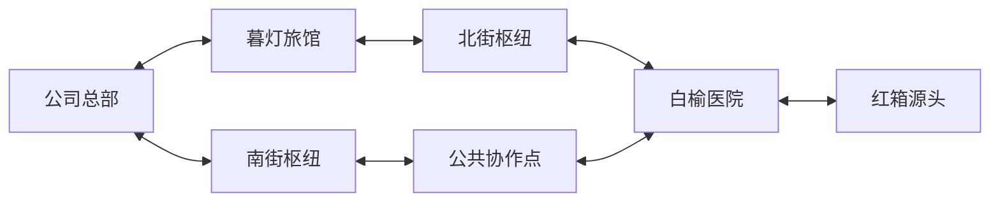
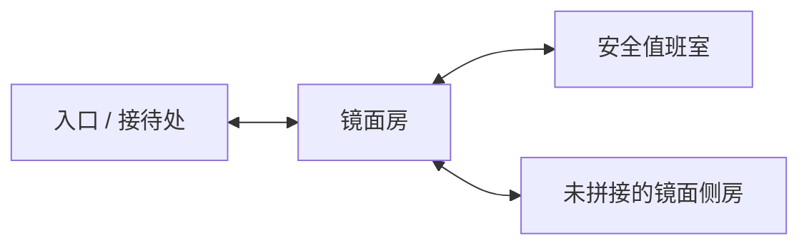

# 地点与室内房间

[返回 Wiki](README.md) · [合同与服务](contracts.md) · [实物与装备](items.md) · [异常守则](anomalies.md) · [经营与现场规则](mechanics.md)

本文包含地点、库存与隐藏规则的完整剧透。设计依据为 `693307638a7d9521b8ee185628d8d685b66e15b2` 的策划 v0.2、需求 v0.3 对齐修订；“M2 可遇到”只指实现提交 `9cbe156779aa38dbce0b798b5db0143df5282846` 的固定场景配置，不代表这些代码已经合入主分支。状态与验证边界见 [来源说明](sources.md)。

## 雾港：当前 M2 固定地图

**M2 可遇到：1 城、7 节点、7 条双向边、3 处手操现场，共 10 个室内房间。** 另有 1 份备用对照样本，它是有限调查资源，不是第 11 个可进入房间。城市名“雾港”来自状态默认值；更换种子不生成另一座城市或改变地图骨架。[城市初值][M-city] [地图定义][W-map] [需求地图][R-map]

两条路线在医院汇合。所有边开局双向可通行，M2 固定账例无交通附加费、无强制抢修；上述箭头不表示单向行走。设施、通路、人员、维护、入侵分别记录，断联不清空库存或合同记录。[边定义][W-map] [边初值][M-edge] [经营规则](mechanics.md)

| 节点 | 位置与相邻地点 | 可以做什么、收益与条件 | 持续性与限制 |
| --- | --- | --- | --- |
| **公司总部** | 北接暮灯旅馆，南接南街枢纽 | 初始资金 16、员工 6；共享仓库、计划与归档中心。提供[工具补充与总部补封装](contracts.md#工程与经营服务)；正常研究入口尚未开放 | 无室内手操；总部本身不作为可接管营业点。仓库物、耗材和次数都是真实实例，不随回访刷新 |
| **暮灯旅馆** | 公司总部 ↔ 旅馆 ↔ 北街枢纽 | [镜中住客](anomalies.md)的 A/B 推理现场；回收[座钟](items.md#镜中住客的座钟)交付 4，首次现场确认零钱 1；有可选灯具与安全便条 | 交付合同、确认并归档所需规程后，建设 4；次日起满足驻站等条件可营业。调查不另付里程碑 |
| **北街枢纽** | 暮灯旅馆 ↔ 枢纽 ↔ 白榆医院 | 北线中转节点，保留绕行选择 | 无室内、异常合同或公开合作资格；当前初始内容没有让它合法接管的合同。压力机制中枢纽被入侵会中断相邻通路，当前 M2 固定箭头并不以它为目标 |
| **白榆医院** | 接北街枢纽、公共协作点、红箱源头 | [病历室规程](anomalies.md)现场；可靠调查 2，交付[回声样本](items.md#回声样本)5；封装公开要求本轮照明 | 满足合同与归档规程后建设 4，次日起可驻站营业。它是两线汇合点，也是当前压力配置的扩张目标 |
| **红箱源头** | 仅与白榆医院相连 | 调查 2，交付[源头红箱](items.md#源头红箱)8；归档确认后配发[源头专用箱](items.md#源头专用箱) | 必需交接目标，不能接管为营业点；交付取消尚未执行的本源头扩张，不撤销已发生的运输入侵 |
| **南街枢纽** | 公司总部 ↔ 枢纽 ↔ 公共协作点 | 南线中转节点；经公共协作点到医院 | 无室内、合同或可接管资格。M2 没有给这段线路投放“南线运输守则” |
| **公共协作点** | 南街枢纽 ↔ 协作点 ↔ 白榆医院 | 开局公开合作，无须先回收异常物；建设 4，次日起满足条件每日营业 1 | 无室内或调查奖励；可代替旅馆或医院成为所需的两个营业点之一，不能代替源头交付 |

节点名称、初始内容、奖励见 [WorldFactory 节点与目标][W-map]、[特殊房间与库存][W-items]。接管条件、源头禁止建设、枢纽无初始接管条件见 [城市受理校验][C-node]；营业资格详见 [mechanics.md](mechanics.md)。

## 暮灯旅馆的四个房间

**下面四项均为 M2 可遇到。** 侧房在首次放置前不可进入；其余三房开局已连接。基础移动每格 1 行动，放置相邻侧房另付 1 行动、1 墨水；放置本身不移动队伍。首次实际进入房间获得 1 墨水，重进不再给。室内结构和库存跨出勤保留。[房网定义][W-rooms] [移动与放房执行][F-move] [放房校验][F-place]

| 房间 | 相邻房间、返程距离 | 内容与用途 | 限制与一次性 |
| --- | --- | --- | --- |
| **入口 / 接待处** | 接镜面房；距出口 0 格 | 免费撤离口；当前 M2 进入旅馆时直接提供同实例旧出勤录像 | 不必集齐合同物或灯才能撤离；无初始实物库存。入口不是镜中住客作用房间 |
| **镜面房** | 接入口、安全值班室、侧房；距入口 1 格 | 首个档案柜只给[寻物记录](items.md#档案柜寻物记录与备用对照样本)，定位第二容器；再次搜查或模仿搜查才可发现座钟。未照明首次正常搜查可区分镜中住客 A/B | 档案柜 1 次、座钟 1 件，回访不刷新。镜中住客作用房间；B 的正常搜查次数按本出勤、本房间累计 |
| **安全值班室** | 只接镜面房；距入口 2 格 | 一份[值班便条](items.md#值班便条)，可在安全库存上打出搜查牌建立模仿参考，再疾走至镜面房或侧房使用 | 不受镜中住客作用；便条无现金、无需封装、不刷新。房门不允许敲门 |
| **未拼接的镜面侧房** | 只接镜面房；放置后距入口 2 格 | 一件[不灭床头灯／侧房灯](items.md#不灭床头灯侧房灯)，占 1 格；公开报价 6 或 2。灯是可选目标，非必经路 | 与镜面房共享同一个镜中住客规则实例，但正常搜查按各自房间计数；放房、往返、搜索、封装均实际付费。取走后不刷新 |

房间特性与内容见 [M2 专用覆盖][W-rooms-m2]、[库存][W-items]。旅馆录像在现场开始时自动取得是当前实现细节，不能据此推断所有地点都免费给调查记录。[现场开始][F-start] 首柜定位不等于发现物品；已发现后拒绝入包的实物可日后直接拾取。[搜查执行][F-search]

## 白榆医院的三个房间

**均为 M2 可遇到，采用固定线形房网，不使用放房。** 医院当前只有“病历室规程”一条地方规则，作用于该现场；任何房间若有合法搜查库存，暗处正常搜查都可能触发它。封装回声样本必须本轮照明。[医院规则][W-rules] [规则作用范围][F-start]

| 房间 | 位置与库存 | 用途、条件与持续性 |
| --- | --- | --- |
| **入口 / 接待处** | 只接回收室；初始无实物 | 免费撤离；可调查可靠记录。距出口 0 格，记录取得后不再生成新记录 |
| **回收室** | 接入口和档案室；初始有唯一回声样本 | 合同搜查与封装地点，距入口 1 格；取走或放下均保留真实位置，不重生样本 |
| **档案室** | 只接回收室；初始无实物 | 可选末端房间，距入口 2 格；当前未投放独有奖励、第二合同或专属谜题，名称不代表自动生成档案收益 |

三个房间来自公共模板，[WorldFactory 房网][W-rooms]；样本的收容条件来自 [M2 目标设置][W-items]。固定病区连接与地铁独立空间特点是设计方向，当前医院仍是这三个模板房间，不能当作完整医院内容池。[设计现场空间][D-field]

## 红箱源头的三个房间

**均为 M2 可遇到，固定线形房网。** 这里的“源头回收规程”处理未封装异常物入包及移动携带后的外溢；地点“红箱源头”和物品“源头专用箱”不是同一个对象。[源头规则][W-rules] [实际携带触发][F-carry]

| 房间 | 位置与库存 | 用途、条件与持续性 |
| --- | --- | --- |
| **入口 / 接待处** | 只接回收室；初始无实物 | 免费撤离，可取得源头可靠记录；不必成功收容才允许撤退 |
| **回收室** | 接入口与档案室；唯一源头红箱占 3 格 | 距入口 1 格；须用配发的专用箱封装，专用箱和红箱都必须真实归库才能交付 |
| **档案室** | 只接回收室；初始无实物 | 距入口 2 格的可选末端；当前没有独立掉落或额外任务 |

房网、目标位置和合同标记见 [公共房间模板][W-rooms]、[目标创建][W-target]；两件实物一起交付见 [源头交付校验][C-deliver]。所有已发现的失败遗落物可出现在实际失败房间，此类状态变化不算新初始掉落点。[失败遗落][F-fail]

## 压力配置：相同地图，另算经营后果

**压力模式**不是第二张地图。当前 `Create(... pressure: true)` 仍使用以上七节点与三类现场；偶数经营日、源头未交付时，预告红箱源头沿医院—源头边向白榆医院扩张。可用合资格服务点封控该边，或在当晚交付源头取消预告。未阻止的入侵使医院失去营业资格。[压力开关][W-pressure] [预告生成][C-forecast]

**代码差异：** 预告文字写“入侵并切断该相邻通路”，但此提交的执行代码仅在目标为枢纽时断开其所有相邻边。M2 目标是医院，按代码只记入侵，不断边。默认 M2 的七条边没有线路规则引用；开启压力也不会自动投放历史的南线运输守则。以上均为只读代码核对，未在本次 Wiki 工作中运行验证。[预告与扩张实现][C-spread] [M2 边定义][W-map]

## 历史地图与已定义、未在 M2 投放的内容

`CreateLegacy` 是同一实现提交保留的历史构造器。它也是七节点，但连接、房名、奖励及库存不同，不能把旧攻略直接用在 M2。[历史构造器][W-legacy]

| 历史节点／房间 | 历史内容与用途 | M2 对照 |
| --- | --- | --- |
| 公司总部、暮灯旅馆、白榆医院、北街枢纽、红箱源头 | 五个同名节点，但总部直连医院，北街枢纽直连源头 | M2 改为两线在医院汇合 |
| **旧城合作站** | 公开合作点，连接旅馆与医院，建设 4 | M2 相同内部节点位置由公共协作点承担，改接南街枢纽与医院 |
| **南线中继** | 连接源头与医院；医院—中继边挂南线运输守则 | M2 称南街枢纽，无该线路守则 |
| 旅馆 **入口 / 接待处** | 撤离及调查口 | M2 同类入口 |
| 旅馆 **旧客房** | 合同“停摆座钟”占 2 格 | M2 改为镜面房、两容器与镜中住客的座钟 |
| 旅馆 **镜厅** | 玻璃门牌占 1 格、标示价值 2；允许敲门 | M2 改为安全值班室、值班便条；不允许敲门 |
| 旅馆 **未拼接的侧房** | 残页透镜，1 格、1 次稀有揭晓；从旧客房放置后进入 | M2 改投侧房灯；透镜未投放 |
| 医院 **入口 / 接待处、回收室、档案室** | 同三个模板房；回声样本仍在回收室，另有暗室病历、值班禁眠两条规则 | M2 只保留一条必需规程，增加样本照明收容条件 |
| 源头 **入口 / 接待处、回收室、档案室** | 同三个模板房；回收室为源头红箱 | M2 使用独立专用箱，旧版用隔离工具 |

历史八条双向边完整为：总部—旅馆、总部—医院、旅馆—北街枢纽、北街枢纽—源头、源头—南线中继、医院—南线中继、旅馆—旧城合作站、医院—旧城合作站。[历史边与规则][W-legacy-map] 历史房网仍是旅馆四房、医院三房、源头三房；未列出第二套隐藏房间。[房间模板][W-rooms]

## 规划范围

三座随机城市、不同城市骨架、完整医院病区和地铁现场，以及调查、工具维护、接应运输、回收仓储四类专业网点，都有设计方向；未获得完整逐项冻结名称、效果或地图池。当前“约 12 件异常物、12 个委托模板”只是完整产品预算，不能据此编造额外地点或房间。[生成需求][R-generation] [专业方向][R-special] [内容预算][D-budget]

[M-city]: https://github.com/bddfs/Joy/blob/9cbe156779aa38dbce0b798b5db0143df5282846/Core/Models.cs#L16-L31
[M-edge]: https://github.com/bddfs/Joy/blob/9cbe156779aa38dbce0b798b5db0143df5282846/Core/Models.cs#L107-L115
[W-map]: https://github.com/bddfs/Joy/blob/9cbe156779aa38dbce0b798b5db0143df5282846/Core/WorldFactory.cs#L19-L35
[W-rules]: https://github.com/bddfs/Joy/blob/9cbe156779aa38dbce0b798b5db0143df5282846/Core/WorldFactory.cs#L36-L52
[W-rooms-m2]: https://github.com/bddfs/Joy/blob/9cbe156779aa38dbce0b798b5db0143df5282846/Core/WorldFactory.cs#L53-L67
[W-items]: https://github.com/bddfs/Joy/blob/9cbe156779aa38dbce0b798b5db0143df5282846/Core/WorldFactory.cs#L58-L82
[W-rooms]: https://github.com/bddfs/Joy/blob/9cbe156779aa38dbce0b798b5db0143df5282846/Core/WorldFactory.cs#L159-L177
[W-target]: https://github.com/bddfs/Joy/blob/9cbe156779aa38dbce0b798b5db0143df5282846/Core/WorldFactory.cs#L179-L185
[W-pressure]: https://github.com/bddfs/Joy/blob/9cbe156779aa38dbce0b798b5db0143df5282846/Core/WorldFactory.cs#L10-L14
[W-legacy]: https://github.com/bddfs/Joy/blob/9cbe156779aa38dbce0b798b5db0143df5282846/Core/WorldFactory.cs#L87-L138
[W-legacy-map]: https://github.com/bddfs/Joy/blob/9cbe156779aa38dbce0b798b5db0143df5282846/Core/WorldFactory.cs#L97-L128
[F-start]: https://github.com/bddfs/Joy/blob/9cbe156779aa38dbce0b798b5db0143df5282846/Core/FieldEngine.cs#L19-L68
[F-move]: https://github.com/bddfs/Joy/blob/9cbe156779aa38dbce0b798b5db0143df5282846/Core/FieldEngine.cs#L140-L200
[F-place]: https://github.com/bddfs/Joy/blob/9cbe156779aa38dbce0b798b5db0143df5282846/Core/FieldEngine.cs#L437-L469
[F-search]: https://github.com/bddfs/Joy/blob/9cbe156779aa38dbce0b798b5db0143df5282846/Core/FieldEngine.cs#L154-L180
[F-carry]: https://github.com/bddfs/Joy/blob/9cbe156779aa38dbce0b798b5db0143df5282846/Core/FieldEngine.cs#L522-L554
[F-fail]: https://github.com/bddfs/Joy/blob/9cbe156779aa38dbce0b798b5db0143df5282846/Core/FieldEngine.cs#L577-L585
[C-node]: https://github.com/bddfs/Joy/blob/9cbe156779aa38dbce0b798b5db0143df5282846/Core/CityEngine.cs#L554-L587
[C-deliver]: https://github.com/bddfs/Joy/blob/9cbe156779aa38dbce0b798b5db0143df5282846/Core/CityEngine.cs#L724-L740
[C-forecast]: https://github.com/bddfs/Joy/blob/9cbe156779aa38dbce0b798b5db0143df5282846/Core/CityEngine.cs#L788-L797
[C-spread]: https://github.com/bddfs/Joy/blob/9cbe156779aa38dbce0b798b5db0143df5282846/Core/CityEngine.cs#L760-L797
[R-map]: https://github.com/bddfs/Joy/blob/693307638a7d9521b8ee185628d8d685b66e15b2/docs/requirements/Joy_需求规格说明书_v0.3.md#L790-L804
[R-generation]: https://github.com/bddfs/Joy/blob/693307638a7d9521b8ee185628d8d685b66e15b2/docs/requirements/Joy_需求规格说明书_v0.3.md#L202-L214
[R-special]: https://github.com/bddfs/Joy/blob/693307638a7d9521b8ee185628d8d685b66e15b2/docs/requirements/Joy_需求规格说明书_v0.3.md#L224
[D-field]: https://github.com/bddfs/Joy/blob/693307638a7d9521b8ee185628d8d685b66e15b2/docs/design/异常回收公司详细策划案_v0.2.md#L174-L190
[D-budget]: https://github.com/bddfs/Joy/blob/693307638a7d9521b8ee185628d8d685b66e15b2/docs/design/异常回收公司详细策划案_v0.2.md#L441-L445
